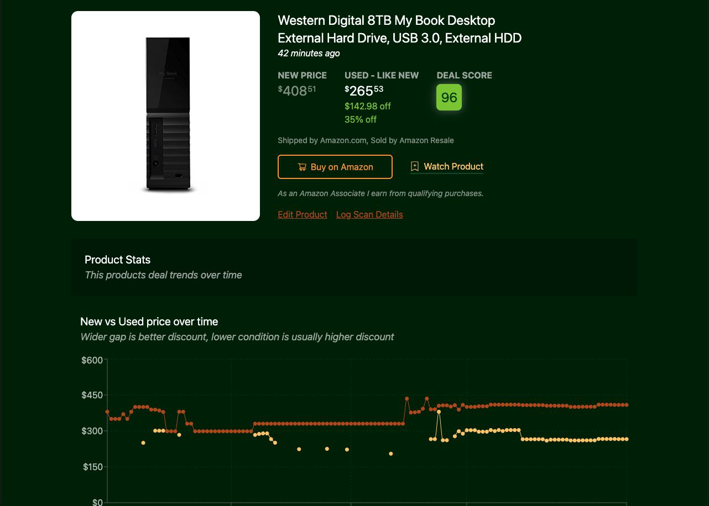
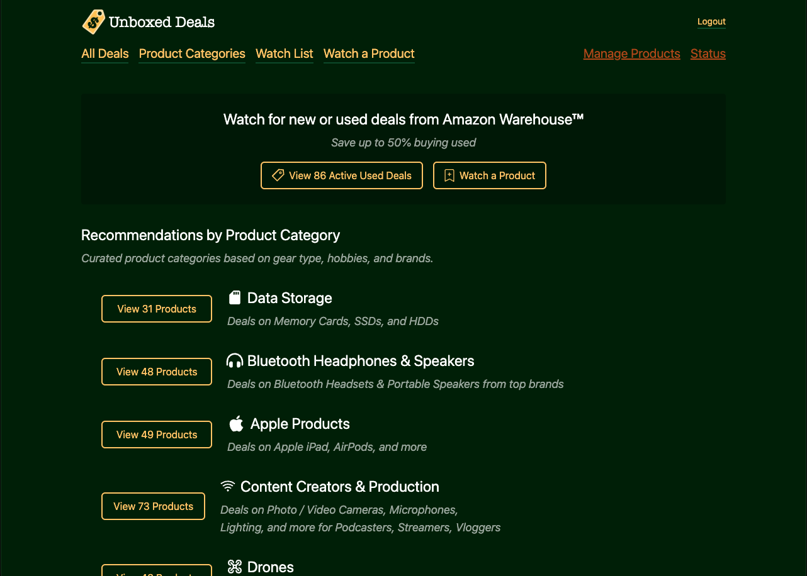
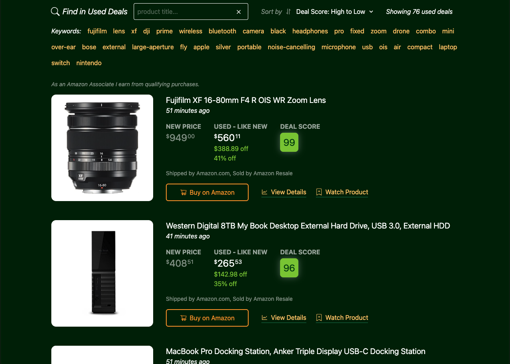
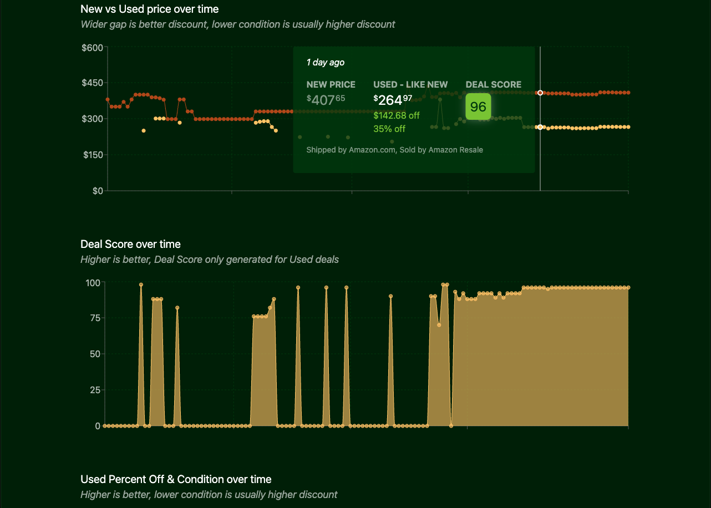
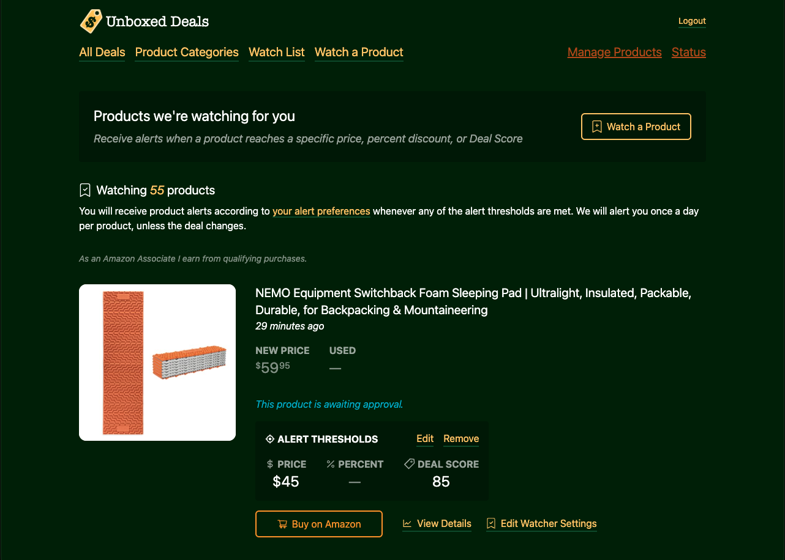
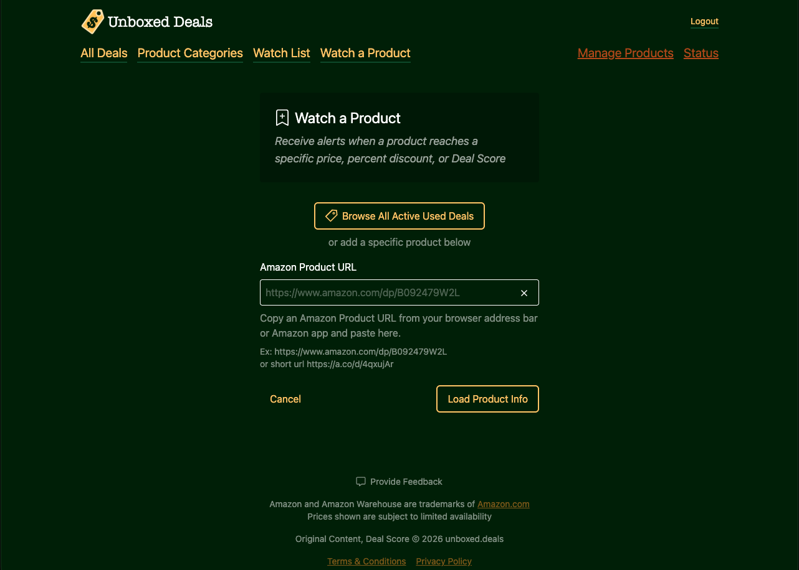

  

<h1 align="center">Unboxed Deals</h1>

<strong>Watch for new or used deals from Amazon Warehouse</strong>

  
  
  
  
  

  <a href="https://unboxed.deals"><strong>unboxed.deals</strong></a> ·
  <a href="https://www.youtube.com/playlist?list=PLDPa5Jo5XXRyo_bPWNEcaKv-Sctm1iTOY">YouTube build playlist</a>

A website for Amazon Warehouse deals on used and open-box items. Unboxed Deals tracks prices
over time, gives every used offer a 0 to 100 **Deal Score**, and alerts you by email or SMS when a
product you're watching hits your price, discount, or score.

> **This is a showcase repo.** Unboxed Deals is a live product and its source code is private.
> This page covers what it does, how it's built, and my role in building it.

## What it does

- **Deal Score for every used offer.** Each offer is scored 0 to 100 against the new price,
  its condition, and who sells and ships it. Weak deals never reach the feed.
- **Price history.** Charts show new vs. used price, Deal Score, and percent off over time, so
  you can tell a real deal from a normal price.
- **Watch list alerts.** Set a target price, percent off, or Deal Score for any product and get
  an email or SMS when it's met, at most once a day per product unless the deal changes.
- **Track any product.** Paste an Amazon URL (full or short link) and Unboxed Deals starts
  tracking it. Admins approve new products before they appear publicly.
- **Curated categories and articles.** Deals are grouped by gear type, hobby, and brand, with
  Markdown product articles alongside.
- **Automatic deal posts.** Notable deals are posted to X/Twitter and removed once the deal
  is gone.

## Feature tour

| | |
|---|---|
|  **Home:** watch for new or used deals from Amazon Warehouse. |  **All deals:** new vs. used price with a Deal Score for every item. |
|  **Price history:** hover any day to see the deal at that time. |  **Watch list:** alerts by price, percent off, or Deal Score. |
|  **Watch a product:** paste any Amazon URL to start tracking it. | |

## My role

**Creator and sole developer.** I designed, built, and run Unboxed Deals end to end, from the
first prototype in 2021 to today. That covers:

- the product and UI design
- the Deal Score model
- the RedwoodJS app (GraphQL API, Prisma schema, React frontend)
- the separate price-collection service and the ingestion pipeline that feeds the app
- email, SMS, and X/Twitter integrations
- hosting, monitoring, and database operations in production

**How it evolved:**

1. 2021: a single Node script that checked a handful of products.
2. 2021 to 2022: a Next.js prototype.
3. 2022: rebuilt from scratch on RedwoodJS. That rebuild is the version running today.
4. 2024: moved hosting to Railway.
5. 2026: a production-hardening pass (stability, memory, and data lifecycle work, see below).

## Engineering highlights

**An explainable Deal Score.** Every offer starts at 100 and loses points for specific, recorded
reasons:

- small savings in dollars or percent
- worse condition (Like New down to Acceptable)
- not sold or shipped by Amazon
- a weak seller rating
- a price above new or above MSRP

Offers that score below 70 are dropped. When there's no new offer to compare against, the score
falls back to MSRP. The UI turns the number into plain advice, such as "Buy Now! It probably won't
get better."

**An hourly ingestion pipeline.** A separate collection service gathers prices for every watched
product and hands each batch to the app through Redis. The app then:

1. stores scans and offers
2. ranks offers
3. sends watcher alerts and social posts
4. compacts and cleans old data

Amazon's Product Advertising API fills in product metadata (title, image, MSRP) through a
hand-written signed request client.

**Exactly-once batch processing.** A platform proxy timed out long requests while the handler
kept running, so the collector retried a batch that was still being processed. The fix has three
layers:

- a Redis lock that fails open if Redis is unavailable
- a check against the existing run log
- a database unique constraint on each run's start time

A cleanup script repaired the affected history.

**A production memory leak, found and fixed.** Two leaks were behind the steadily growing memory:

- An ORM `distinct` query ran in application memory instead of SQL, reading about 24x the rows
  it needed. It was replaced with a grouped aggregate.
- A tracing integration kept finished transactions alive. It now runs in an async context.

After both fixes, memory held flat at about 250 MB over long runs and the scheduled restarts were
retired. A small memory telemetry module stays in to catch regressions.

**A data lifecycle that keeps Postgres lean.**

- Price history is kept for 91 days.
- After two days, scans are compacted to the best scan per day.
- Products that stop showing offers retire automatically.
- Index maintenance runs online (`REINDEX CONCURRENTLY`, with invalid-index detection).
- Production database clones are scrubbed of personal data, and that scrubbing has its own
  tests.

**Careful alert delivery.**

- Email goes through SendGrid and SMS through Twilio, with STOP and START handling.
- Alerts are deduplicated per product, per target, per day.
- Unsubscribe links are safe against mail-client link prefetching and don't reveal which alerts
  exist.
- Email verification and per-channel unsubscribe.

**Hardened serving.** A custom server runs the web and API Fastify servers in one process so
security headers apply to both. Errors and traces go to Sentry.

## Tech stack

| Layer | Tools |
|---|---|
| App framework | RedwoodJS 7 (React 18, GraphQL, Prisma), TypeScript, Vite |
| UI | Tailwind CSS, Recharts, Markdown content |
| Data | PostgreSQL, Redis |
| Integrations | Amazon Product Advertising API, SendGrid, Twilio, X/Twitter API, Sentry |
| Testing | Jest with Redwood scenarios |
| Hosting | Railway |

## By the numbers

- **580+ commits** since the RedwoodJS rebuild in May 2022, plus the 2021 prototypes
- **35k+ lines of TypeScript** across the API and web sides
- **500+ automated tests** in 73 test files
- **18 data models**, **62 schema migrations**, **17 GraphQL schemas**, and **45 pages**

---

Unboxed Deals is a participant in the Amazon Associates program. Amazon and Amazon Warehouse are
trademarks of Amazon.com.

Copyright (c) 2022-2026 ched.dev. All rights reserved. ·
[unboxed.deals](https://unboxed.deals) · [ched.dev](https://ched.dev)
